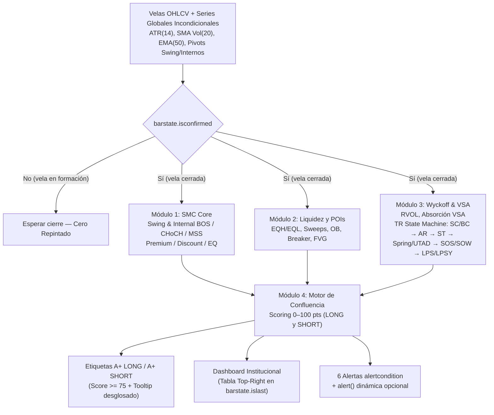
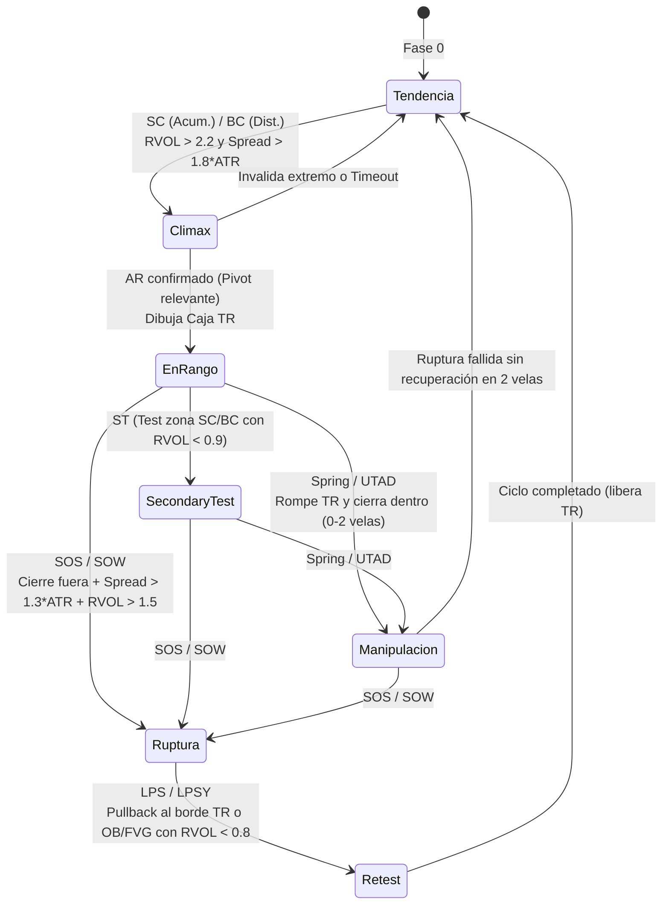

# SMC + Wyckoff Institutional Engine (Pine Script v6)


**SMC + Wyckoff Institutional Engine** es un indicador algorítmico para **TradingView** escrito íntegramente en **Pine Script v6** que unifica tres pilares del análisis institucional en un solo motor objetivo, sin subjetividad y con garantía estricta **anti-repintado**:

1. **Smart Money Concepts (SMC)**: estructura dual (Swing + Interna), `BOS`, `CHoCH`, `MSS` con desplazamiento, zonas dinámicas `Premium / Discount / Equilibrium`, liquidez (`EQH`/`EQL`, `Liquidity Sweeps`), `Order Blocks`, `Breaker Blocks` y `Fair Value Gaps`.
2. **Volume Spread Analysis (VSA)**: medición cuantitativa de la *Ley de Esfuerzo vs. Resultado* mediante `RVOL`, `Spread Relativo` y anomalías de absorción institucional.
3. **Metodología Wyckoff Algorítmica**: máquina de estados finita que detecta `Trading Ranges` de **Acumulación** y **Distribución** con sus eventos clave (`SC`/`BC`, `AR`, `ST`, `Spring`/`UTAD`, `SOS`/`SOW`, `LPS`/`LPSY`).
4. **Motor de Confluencia (0 a 100 puntos)**: puntúa automáticamente cada setup cuando SMC, VSA y Wyckoff coinciden y dispara señales `A+ LONG` / `A+ SHORT`, Dashboard en tiempo real y alertas listas para operar.

---

## Tabla de Contenidos

- [Estructura del Repositorio](#estructura-del-repositorio)
- [Arquitectura General del Motor](#arquitectura-general-del-motor)
- [Garantía Anti-Repintado y Gestión de Memoria](#garantía-anti-repintado-y-gestión-de-memoria)
- [Módulo 1: Estructura de Mercado (SMC Core)](#módulo-1-estructura-de-mercado-smc-core)
- [Módulo 2: Liquidez y Puntos de Interés (POIs)](#módulo-2-liquidez-y-puntos-de-interés-pois)
- [Módulo 3: Motor Wyckoff y VSA](#módulo-3-motor-wyckoff-y-vsa)
- [Módulo 4: Motor de Confluencia (Scoring 0–100)](#módulo-4-motor-de-confluencia-scoring-0100)
- [Dashboard Institucional](#dashboard-institucional)
- [Sistema de Alertas](#sistema-de-alertas)
- [Referencia Completa de Parámetros (Inputs)](#referencia-completa-de-parámetros-inputs)
- [Instalación en TradingView](#instalación-en-tradingview)
- [Validación Estática Local (Pine Script v6)](#validación-estática-local-pine-script-v6)
- [Recomendaciones de Uso y Timeframes](#recomendaciones-de-uso-y-timeframes)
- [Aviso de Riesgo](#aviso-de-riesgo)

---

## Estructura del Repositorio

```text
.
├── README.md                                 # Resumen técnico e instalación
├── .gitignore                                # Exclusiones de Git
├── docs/
│   ├── README.md                             # Índice maestro de la Guía Educativa
│   ├── 01-estructura-de-mercado-smc.md       # Módulo 1: Pivotes, BOS, CHoCH, MSS, P/D
│   ├── 02-liquidez-y-pois.md                 # Módulo 2: BSL/SSL, EQH/EQL, Sweeps, OB, Breaker, FVG
│   ├── 03-wyckoff-y-vsa.md                   # Módulo 3: Leyes Wyckoff, VSA, TR y Eventos
│   ├── 04-confluencia-y-motor-aplicado.md    # Módulo 4 (Recap): Scoring 0-100, Dashboard y Playbook
│   ├── glosario.md                           # Glosario rápido A–Z
│   └── SPEC.md                               # Especificación técnica original
├── src/
│   └── smc_wyckoff_institutional_engine.pine # Indicador completo en Pine Script v6
└── scripts/
    └── validate_pine_v6.py                   # Validador estático de sintaxis v6 y SPEC
```

> **¿Querés aprender a fondo todos los conceptos teóricos y cómo se aplican paso a paso en el indicador?** Empezá por la **[Guía Educativa Completa (`docs/README.md`)](./docs/README.md)**.

---

## Arquitectura General del Motor

El indicador procesa el mercado en capas determinísticas: primero calcula todas las series técnicas en el ámbito global (sin ejecución condicional que degrade `ta.*`), luego ejecuta los tres módulos de análisis estrictamente al cierre de cada vela (`barstate.isconfirmed`), alimenta el motor de confluencia y finalmente renderiza los dibujos acotados, el dashboard y las alertas.



---

## Garantía Anti-Repintado y Gestión de Memoria

### 1. Regla Anti-Repintado (Zero Lookahead)
- **Series causales incondicionales**: `ta.atr(14)`, `ta.sma(volume, 20)`, `ta.ema(close, 50)`, `ta.pivothigh(...)` y `ta.pivotlow(...)` se evalúan en cada barra en el ámbito global, evitando inconsistencias derivadas de la evaluación perezosa (`and`/`or` short-circuit) de Pine Script v6.
- **Confirmación de pivotes sin datos futuros**: `ta.pivothigh(high, L, L)` y `ta.pivotlow(low, L, L)` confirman un pivote únicamente cuando transcurren `L` velas posteriores. El pivote se ancla visualmente en su vela histórica real (`bar_index - L`), pero los eventos dependientes **nunca** se proyectan hacia atrás.
- **Cierre de vela obligatorio**: Todas las rupturas (`BOS`, `CHoCH`, `MSS`), barridos (`Sweeps`), creación/mitigación de `OB`/`FVG`, eventos `Wyckoff`, cálculos de puntaje `0–100`, etiquetas `A+` y alertas se evalúan exclusivamente dentro de `if barstate.isconfirmed`. Lo que ves en el historial es exactamente lo que dispara en tiempo real.

### 2. Gestión de Memoria mediante UDTs (`type`) y Arrays Acotados
TradingView impone límites estrictos (`max_boxes_count=500`, `max_lines_count=500`, `max_labels_count=500`). Para operar en historiales de miles de velas sin errores de ejecución, el indicador modela todos sus objetos con **User Defined Types (UDTs)** nativos de Pine Script v6 y aplica poda FIFO automática (`array.shift` + `box.delete`/`line.delete`/`label.delete`) cuando se supera el máximo configurado:

| UDT (`type`) | Propósito | Limpieza automática |
|---|---|---|
| `SwingPoint` | Pivotes Swing e Internos (`price`, `barIdx`, `isHigh`, `broken`, `swept`) | Historial acotado (15 últimos por tipo) |
| `EqualLevel` | Pools de liquidez `EQH`/`EQL` (`$$$`) con su línea y etiqueta | Configurable (`i_maxEQ`, default `15`) |
| `OrderBlock` | Bloques institucionales y `Breaker Blocks` con estado de mitigación | Configurable (`i_maxOB`, default `10`) |
| `FVG` | Fair Value Gaps activos con recorte parcial dinámico | Configurable (`i_maxFVG`, default `15`) |
| `TradingRange` | Estado completo de la máquina de estados Wyckoff y caja del TR | Historial de cajas/líneas (`i_maxTRHistory`, default `4`) |
| `StructDrawing` | Pares línea + etiqueta para `BOS`, `CHoCH`, `MSS` | Configurable (`i_maxStructLines`, default `40`) |

---

## Módulo 1: Estructura de Mercado (SMC Core)

El motor rastrea **dos capas estructurales independientes en paralelo**:

- **Estructura Swing** (default `25` velas): define la dirección macro del activo (`BOS`, `CHoCH`, `MSS`).
- **Estructura Interna** (default `5` velas): captura cambios de flujo de órdenes de corto plazo (`iBOS`, `iCHoCH`, `iMSS`).

### Reglas de Clasificación Estructural

| Evento | Condición Algorítmica | Estilo Visual |
|---|---|---|
| **Confirmación de Ruptura** | Configurable: por **Cierre** (`close`, default más estricto) o por **Mecha** (`high`/`low`). | — |
| **BOS** (*Break of Structure*) | Ruptura a favor de la tendencia vigente (rompe el último High en tendencia alcista o el último Low en tendencia bajista). | Línea discontinua |
| **CHoCH** (*Change of Character*) | Primera ruptura en contra de la tendencia vigente (sin cumplir criterio de desplazamiento). | Línea discontinua |
| **MSS** (*Market Structure Shift*) | Un `CHoCH` acompañado de **Desplazamiento institucional**: cuerpo `math.abs(close - open) > 1.5 * ta.atr(14)` **y** volumen `volume > 1.2 * ta.sma(volume, 20)`. | Línea sólida gruesa |

### Zonas Premium / Discount / Equilibrium
Calculadas dinámicamente entre el último **Swing High** y **Swing Low** confirmados:

- **Premium (`50% – 100%`)**: zona cara, favorable para ventas institucionales.
- **Equilibrium (`50%`)**: línea media de equilibrio del rango estructural.
- **Discount (`0% – 50%`)**: zona barata, favorable para compras institucionales.

---

## Módulo 2: Liquidez y Puntos de Interés (POIs)

### Equal Highs / Equal Lows (`$$$ EQH` / `$$$ EQL`)
- Detecta dos o más pivotes no rotos ni barridos cuya diferencia de precio es menor o igual a `0.15 * ta.atr(14)` (configurable).
- Dibuja una línea punteada uniendo los máximos/mínimos iguales etiquetada como `$$$ EQH` / `$$$ EQL` (o `$$$` en estructura interna).

### Liquidity Sweeps (`⚡ Sweep`)
- Se dispara cuando una vela perfora con la mecha un `Swing High`/`Low` previo o un nivel `EQH`/`EQL` activo, pero **cierra nuevamente dentro del rango**:
  - **BSL Sweep (Bajista)**: `high > nivel` y `close < nivel`.
  - **SSL Sweep (Alcista)**: `low < nivel` y `close > nivel`.
- El nivel queda marcado como barrido para evitar señales duplicadas y alimenta inmediatamente los `+25 pts` de manipulación del motor de confluencia.

### Order Blocks (`OB+` / `OB-`) y Breaker Blocks (`BB+` / `BB-`)
- **Condición de validez**: cuando se produce una ruptura (`BOS`, `CHoCH` o `MSS`) precedida por desplazamiento (en la vela de ruptura o hasta 3 velas antes), el motor busca hacia atrás (hasta `i_obLookback`, default `15` velas) la **última vela contraria al impulso**:
  - **OB Alcista (`OB+`)**: última vela bajista (`close < open`) previa al impulso alcista.
  - **OB Bajista (`OB-`)**: última vela alcista (`close > open`) previa al impulso bajista.
- **Modos de mitigación configurables**:
  1. `Proximal`: el OB se mitiga al tocar el borde cercano (`low <= ob.top` / `high >= ob.bottom`).
  2. `50% Mean Threshold` *(default)*: se mitiga cuando el precio alcanza el 50% del bloque (`ob.mid`).
  3. `Distal Invalidation`: permanece activo hasta un cierre más allá del extremo opuesto.
- **Conversión a Breaker Block (opcional, activo por default)**: si un OB válido es invalidado con fuerza mediante **cierre más allá de su extremo distal** (`close < ob.bottom` en OB alcista, `close > ob.top` en OB bajista), el bloque **invierte su polaridad** (soporte ↔ resistencia), cambia su estilo a borde discontinuo azul/naranja y pasa a etiquetarse como `BB+` o `BB-` hasta que ese Breaker sea invalidado.

### Fair Value Gaps (`FVG+` / `FVG-`)
- **FVG Alcista**: `low > high[2]` con tamaño `(low - high[2]) > 0.25 * ta.atr(14)`.
- **FVG Bajista**: `high < low[2]` con tamaño `(low[2] - high) > 0.25 * ta.atr(14)`.
- **Mitigación dinámica**:
  - En modo `100% Fill` *(default)*: el box se **recorta progresivamente** a medida que el precio rellena parcialmente el inbalance y se elimina al completarse el 100%.
  - En modo `50% Fill`: se elimina al alcanzarse el 50% (Consequent Encroachment).

---

## Módulo 3: Motor Wyckoff y VSA

### A. Ley de Esfuerzo vs. Resultado (VSA)
El motor calcula en cada vela:
- **Volumen Relativo (`RVOL`)**: `volume / ta.sma(volume, 20)`
- **Spread Relativo**: `(high - low) / ta.atr(14)`
- **Anomalía de Absorción (Esfuerzo sin Resultado)**:
  - `RVOL > 1.8` **combinado con** cuerpo pequeño (`math.abs(close - open) < 0.35 * (high - low)`) **o** mecha de rechazo `> 50%` del rango de la vela.
  - Se visualiza mediante un diamante discreto (`plotshape`) debajo/encima de la vela sin consumir cuota de `labels`, indicando frenado institucional.

### B. Máquina de Estados del Trading Range (TR)



### Reglas Algorítmicas de Eventos Wyckoff

| Evento | Acumulación (Compra) | Distribución (Venta) |
|---|---|---|
| **SC / BC** | Tras tendencia bajista, vela con `RVOL > 2.2` y `Spread > 1.8 * ATR` que cierra en el tercio superior (`>= 66%`) o es seguida en la vela inmediata por rechazo alcista. Define el **piso del TR**. | Tras tendencia alcista, vela con `RVOL > 2.2` y `Spread > 1.8 * ATR` que cierra en el tercio inferior (`<= 34%`) o es seguida por rechazo bajista. Define el **techo del TR**. |
| **AR** | Primer Swing/Internal High relevante tras el SC (`> piso + 0.5*ATR`). Define el **techo del TR**. | Primer Swing/Internal Low relevante tras el BC (`< techo - 0.5*ATR`). Define el **piso del TR**. |
| **ST** | Testeo del 25% inferior del TR sin cerrar debajo del piso, con volumen bajo (`RVOL < 0.9`). | Testeo del 25% superior del TR sin cerrar encima del techo, con volumen bajo (`RVOL < 0.9`). |
| **Spring / UTAD** | Rompe el piso del TR y cierra nuevamente dentro del TR en la **misma vela o en las 1–2 velas siguientes**. | Rompe el techo del TR y cierra nuevamente dentro del TR en la **misma vela o en las 1–2 velas siguientes**. |
| **SOS / SOW** | Cierre decidido sobre el techo del TR con `Spread > 1.3 * ATR` y `RVOL > 1.5`. | Cierre decidido bajo el piso del TR con `Spread > 1.3 * ATR` y `RVOL > 1.5`. |
| **LPS / LPSY** | Retroceso post-SOS hacia el borde superior del TR o hacia un OB/FVG alcista con volumen decreciente (`RVOL < 0.8`). | Retroceso post-SOW hacia el borde inferior del TR o hacia un OB/FVG bajista con volumen decreciente (`RVOL < 0.8`). |

---

## Módulo 4: Motor de Confluencia (Scoring 0–100)

El valor diferencial del indicador es evaluar simultáneamente la alineación entre SMC, VSA y Wyckoff dentro de una ventana de confluencia configurable (`i_confWindow`, default `25` velas), produciendo un puntaje en vivo tanto para **LONG** como para **SHORT**:

| Factor de Confluencia | Puntos | Condición LONG | Condición SHORT |
|---|---:|---|---|
| **1. Manipulación** | **+25** | `Spring` o `SSL Liquidity Sweep` reciente | `UTAD` o `BSL Liquidity Sweep` reciente |
| **2. Estructura con Fuerza** | **+25** | `MSS` alcista o `SOS` reciente | `MSS` bajista o `SOW` reciente |
| **3. Zona de Valor** | **+20** | Precio reaccionando en zona **Discount** (`low <= EQ 50%`) | Precio reaccionando en zona **Premium** (`high >= EQ 50%`) |
| **4. POI Institucional** | **+15** | `OB+` / `BB+` o `FVG+` sin mitigar activo/reciente | `OB-` / `BB-` o `FVG-` sin mitigar activo/reciente |
| **5. Confirmación de Volumen** | **+15** | `VSA Absorción Alcista`, `ST` o `LPS` reciente | `VSA Absorción Bajista`, `ST` o `LPSY` reciente |
| **Total Máximo** | **100** | — | — |

### Señales `A+ LONG` y `A+ SHORT`
- Solo se muestran cuando el puntaje alcanza el umbral configurado (`score >= 75` por defecto), ocurre un disparador fresco en la vela cerrada (`Spring/UTAD`, `Sweep`, `MSS`, `SOS/SOW`, `LPS/LPSY` o reacción en `OB` activo) y se respetó el cooldown entre señales (`i_signalCooldown`).
- Al pasar el cursor sobre cada etiqueta `A+ LONG (XX)` o `A+ SHORT (XX)`, el **tooltip interactivo** muestra el desglose exacto de puntos obtenidos en cada uno de los 5 criterios.

#### Ejemplo real de un setup `A+ LONG (100/100)`
1. El precio cae en tendencia bajista hacia zona **Discount** (`+20 pts`) y forma un `SC` + `AR`.
2. Hace un barrido por debajo del rango (`Spring` / `⚡ Sweep`) absorbiendo liquidez (`+25 pts`) con volumen de frenado `VSA Absorción` (`+15 pts`).
3. Reacciona al alza generando un `MSS` / `SOS` con desplazamiento (`+25 pts`) y dejando un `OB+` + `FVG+` sin mitigar en el origen (`+15 pts`).
4. Resultado: **100 / 100 → Etiqueta `A+ LONG (100)` + Alerta disparada al cierre de la vela**.

---

## Dashboard Institucional

Ubicado en la esquina superior derecha del gráfico (actualizado únicamente en `barstate.islast` para máximo rendimiento):

| Fila | Información mostrada |
|---|---|
| **Tendencia Swing** | `Alcista` (verde) / `Bajista` (rojo) / `Neutral` (gris) |
| **Tendencia Interna** | `Alcista` / `Bajista` / `Neutral` |
| **Zona Actual** | `Premium` / `Discount` / `Equilibrium` / `N/A` |
| **Estado Wyckoff** | `Tendencia`, `Clímax (SC/BC)`, `En Rango (Acum./Dist.)`, `Secondary Test (ST)`, `Spring`/`UTAD`, `SOS`/`SOW`, `LPS`/`LPSY` |
| **Último Score A+** | Puntaje y dirección de la última señal A+ confirmada (ej. `85 / 100 (LONG)`) |
| **Score Vivo (L / S)** | Puntaje en tiempo real actual para ambos sesgos (`L: XX \| S: YY`) |
| **POIs / Volumen** | Conteo de `OB` y `FVG` activos sin mitigar + `RVOL` de la vela actual |

---

## Sistema de Alertas

Todas las alertas se disparan **estrictamente al cierre de la vela confirmada** (sin falsas alertas intrabarra).

### Alertas `alertcondition` integradas (Panel de Alertas de TradingView)
1. **`Nueva Señal A+ LONG`**: nueva señal alcista con puntaje `>= umbral`.
2. **`Nueva Señal A+ SHORT`**: nueva señal bajista con puntaje `>= umbral`.
3. **`Nueva Señal A+ (LONG o SHORT)`**: alerta combinada para ambos sentidos.
4. **`Detección de Spring / UTAD`**: evento de manipulación Wyckoff confirmado.
5. **`Detección de MSS`**: cambio de estructura con desplazamiento institucional.
6. **`Precio Entrando en Order Block Activo`**: cuando el precio ingresa a cualquier `OB` o `Breaker` vigente.

### Alertas dinámicas opcionales (`alert()`)
Activando **`Activar alert() Dinámicas con Puntaje`** en el Grupo 4 y creando una alerta en TradingView con la condición *"Any alert() function call"*, recibirás el mensaje con el puntaje exacto en tiempo real:
```text
A+ LONG | BTCUSDT (15) | Score: 85/100 @ 91420.5
```

---

## Referencia Completa de Parámetros (Inputs)

<details>
<summary><strong>0. Estética y Tema Visual (Minimalista)</strong> (clic para expandir)</summary>

| Parámetro | Default | Descripción |
|---|---|---|
| Tema Visual | `"Minimal Light (Monocromo)"` | Optimizado para fondo blanco + velas negras (`Minimal Light (Monocromo)`, `Minimal Light (Acento Sutil)` o `Dark Institutional`) |
| Mostrar Etiquetas dentro de Cajas (OB/FVG/TR) | `false` | Mantiene cajas limpias sin texto; activalo para ver micro-etiquetas `OB+`/`FVG+`/`TR` |
| Tamaño Texto Dashboard | `"Pequeño"` | Tipografía compacta (`Pequeño` = `size.tiny` o `Normal` = `size.small`) |
| Color Cajas Imbalance (FVG) | `#9CA3AF` | Gris neutro minimalista para Fair Value Gaps |
| Color Tinta Principal (Light) | `#111318` | Negro grafito para líneas de estructura y texto principal |
| Color Gris Secundario | `#6B7280` | Gris técnico para niveles EQH/EQL, Wyckoff secundarios y etiquetas suaves |

</details>

<details>
<summary><strong>1. Estructura SMC</strong> (clic para expandir)</summary>

| Parámetro | Default | Descripción |
|---|---|---|
| Mostrar Estructura Swing | `true` | Activa/oculta líneas `BOS`/`CHoCH`/`MSS` de marco Swing |
| Lookback Estructura Swing | `25` | Ventana izquierda/derecha para pivotes Swing (`5–100`) |
| Mostrar Estructura Interna | `true` | Activa/oculta líneas `iBOS`/`iCHoCH`/`iMSS` internas |
| Lookback Estructura Interna | `5` | Ventana izquierda/derecha para pivotes internos (`2–30`) |
| Confirmación de Ruptura | `"Close"` | Ruptura por `"Close"` (cierre) o `"Wick"` (mecha) |
| Desplazamiento: Cuerpo > ATR * | `1.5` | Multiplicador mínimo de ATR(14) del cuerpo para MSS/OB |
| Desplazamiento: Volumen > SMA20 * | `1.2` | Multiplicador mínimo de SMA(vol, 20) para MSS/OB |
| Mostrar Zonas Premium / Discount / EQ | `true` | Activa/oculta las cajas Premium/Discount y línea 50% |
| Máx. Líneas de Estructura | `40` | Límite dinámico de dibujos estructurales en gráfico |
| Colores Alcista / Bajista / EQ | `#089981` / `#F23645` / `#787B86` | Paleta principal del indicador |

</details>

<details>
<summary><strong>2. Liquidez y POIs</strong> (clic para expandir)</summary>

| Parámetro | Default | Descripción |
|---|---|---|
| Mostrar Equal Highs / Lows (EQH/EQL) | `true` | Detecta y dibuja pools `$$$` |
| Tolerancia EQH/EQL (ATR *) | `0.15` | Distancia máxima entre pivotes para considerarlos iguales |
| Máx. Niveles EQH/EQL | `15` | Límite dinámico de líneas `EQH`/`EQL` |
| Mostrar Liquidity Sweeps | `true` | Muestra etiquetas `⚡ Sweep` en barridos |
| Máx. Etiquetas de Sweep | `25` | Límite dinámico de etiquetas de barrido |
| Mostrar Order Blocks (OB) | `true` | Dibuja bloques `OB+` / `OB-` |
| Máx. Order Blocks Activos | `10` | Límite dinámico de OBs vigentes |
| Búsqueda Vela OB (Velas) | `15` | Máximo de velas hacia atrás para hallar la vela contraria |
| Modo Mitigación OB | `"50% Mean Threshold"` | `"Proximal"`, `"50% Mean Threshold"` o `"Distal Invalidation"` |
| Convertir OB Invalidado en Breaker Block | `true` | Convierte OBs rotos con cierre en `BB+` / `BB-` |
| Mostrar Fair Value Gaps (FVG) | `true` | Dibuja inbalances `FVG+` / `FVG-` |
| Máx. FVGs Activos | `15` | Límite dinámico de FVGs vigentes |
| Filtro Ruido FVG (ATR *) | `0.25` | Tamaño mínimo del gap relativo al ATR(14) |
| Modo Mitigación FVG | `"100% Fill"` | `"100% Fill"` (con recorte progresivo) o `"50% Fill"` |

</details>

<details>
<summary><strong>3. Motor Wyckoff & VSA</strong> (clic para expandir)</summary>

| Parámetro | Default | Descripción |
|---|---|---|
| Mostrar Eventos Wyckoff | `true` | Etiquetas `SC`, `BC`, `AR`, `ST`, `SPRING`, `UTAD`, `SOS`, `SOW`, `LPS`, `LPSY` |
| Mostrar Cajas de Trading Range (TR) | `true` | Caja sombreada y bordes discontinuos del TR |
| Mostrar Anomalías VSA (Absorción) | `true` | Diamantes discretos en velas de absorción |
| Máx. Cajas TR en Historial | `4` | Cajas de TR simultáneas conservadas en gráfico |
| Máx. Etiquetas Wyckoff | `40` | Límite dinámico de etiquetas de eventos Wyckoff |
| VSA Absorción: RVOL > | `1.8` | Umbral de volumen relativo para anomalía de absorción |
| SC/BC Clímax: RVOL > | `2.2` | Umbral de volumen relativo para Selling/Buying Climax |
| SC/BC Clímax: Spread > ATR * | `1.8` | Umbral de spread relativo para Selling/Buying Climax |
| ST Secondary Test: RVOL < | `0.9` | Volumen máximo permitido para validar un Secondary Test |
| SOS/SOW Ruptura: RVOL > | `1.5` | Volumen mínimo para confirmar ruptura SOS/SOW |
| SOS/SOW Ruptura: Spread > ATR * | `1.3` | Spread mínimo para confirmar ruptura SOS/SOW |
| LPS/LPSY Retroceso: RVOL < | `0.8` | Volumen decreciente máximo en retroceso LPS/LPSY |
| Duración Máx. Trading Range (Velas) | `150` | Límite de vida de un TR antes de liberarlo |

</details>

<details>
<summary><strong>4. Confluencia, Dashboard y Alertas</strong> (clic para expandir)</summary>

| Parámetro | Default | Descripción |
|---|---|---|
| Puntaje Mínimo Señal A+ (0-100) | `75` | Score mínimo requerido para imprimir `A+ LONG`/`A+ SHORT` |
| Ventana de Confluencia (Velas) | `25` | Memoria en velas para combinar eventos SMC + Wyckoff + VSA |
| Cooldown entre Señales A+ (Velas) | `5` | Velas mínimas de separación entre señales del mismo sentido |
| Mostrar Etiquetas A+ LONG / A+ SHORT | `true` | Activa/oculta señales finales en gráfico |
| Máx. Etiquetas Señal A+ | `30` | Límite dinámico de etiquetas de señal |
| Mostrar Dashboard Institucional | `true` | Activa/oculta la tabla en esquina superior derecha |
| Activar `alert()` Dinámicas con Puntaje | `false` | Emite alertas dinámicas con score exacto para webhooks/bots |

</details>

---

## Instalación en TradingView

1. Abrí un gráfico en [TradingView](https://www.tradingview.com/) (asegurate de usar un símbolo con datos de volumen reales o volumen tick).
2. En el panel inferior, abrí la pestaña **Pine Editor**.
3. Creá un nuevo indicador en blanco y borrá el código de ejemplo.
4. Copiá el contenido íntegro de [`src/smc_wyckoff_institutional_engine.pine`](src/smc_wyckoff_institutional_engine.pine) y pegalo en el editor.
5. Hacé clic en **Guardar** (*Save*) y luego en **Añadir al gráfico** (*Add to chart*).
6. *(Opcional)* Configurá tus alertas desde el ícono de reloj (🔔) seleccionando **SMC + Wyckoff Institutional Engine** como condición.

---

## Validación Estática Local (Pine Script v6)

El repositorio incluye un auditor estático en Python 3 para verificar reglas críticas de Pine Script v6 antes de pegar modificaciones en TradingView (sin `transp=`, sin `bool = na`, sin llamadas v4 heredadas, paréntesis/corchetes balanceados, `ta.*` incondicionales, `alertcondition` en ámbito global y chequeo completo contra el SPEC):

```bash
python3 scripts/validate_pine_v6.py src/smc_wyckoff_institutional_engine.pine
```

Salida esperada:
```text
=== Pine Script v6 Static Validation: smc_wyckoff_institutional_engine.pine ===
Errors        : 0
Warnings      : 0
RESULT: PASS — Pine Script v6 syntax & SPEC checks passed.
```

---

## Recomendaciones de Uso y Timeframes

- **Activos recomendados**: Criptomonedas con volumen spot/perpetuos (`BINANCE:BTCUSDT`, `ETHUSDT`), Futuros regulados (`CME:ES1!`, `NQ1!`, `GC1!`), Acciones líquidas (`NASDAQ:NVDA`, `AAPL`) y Forex con buen volumen tick (`OANDA:EURUSD`, `XAUUSD`). *Evitá índices sin volumen reportado (`volume = 0`), ya que el motor VSA/Wyckoff requiere volumen para calcular `RVOL`.*
- **Timeframes óptimos**:
  - **Intradía / Scalping institucional**: `5m` y `15m` (Lookback Swing `20–25`, Interno `5`).
  - **Swing Trading**: `1H`, `4H` y `1D` (Lookback Swing `25–35`, Ventana de Confluencia `25–35`).
- **Ajuste de selectividad**:
  - Para máxima exigencia (pocas señales de altísima confluencia): subí `Puntaje Mínimo Señal A+` a `85` o `90`.
  - Para mercados más rápidos: bajalo a `70` o reducí `Lookback Estructura Swing` a `15–20`.

---

## Aviso de Riesgo

Este software se proporciona únicamente con fines educativos, de investigación y análisis técnico. Ninguna señal, puntaje o patrón detectado constituye asesoramiento financiero ni garantía de resultados futuros. Operá siempre con gestión de riesgo adecuada.
