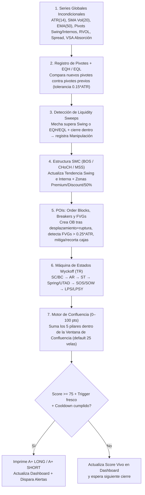

# Módulo 4 (Recap) — Cómo se Integra Todo en Nuestro Indicador

> **Objetivo de este capítulo:** Conectar todos los conceptos vistos en los Módulos 1, 2 y 3 y explicar **exactamente cómo funciona por dentro el `SMC + Wyckoff Institutional Engine`**, cómo calcula el puntaje `0–100`, cómo leer el gráfico minimalista en tiempo real y cómo usarlo en tu operativa diaria.

---

## 1. ¿Por Qué Combinar SMC + VSA + Wyckoff?

Cada metodología por separado tiene un punto ciego:

| Metodología sola | Fortaleza | Punto ciego si se usa aislada |
|---|---|---|
| **Solo SMC** | Mapea con precisión la estructura, los pools de liquidez y las zonas exactas de entrada (`OB`, `FVG`, `Discount/Premium`). | Ignora el volumen relativo y suele dar demasiados Order Blocks y CHoCH falsos en rangos laterales. |
| **Solo Wyckoff / VSA** | Entiende la intención del dinero institucional (acumulación, absorción, agotamiento de oferta/demanda). | Sus zonas de entrada son amplias y a menudo subjetivas si no se anclan a un `OB`/`FVG` o nivel de equilibrio exacto. |
| **SMC + Wyckoff + VSA (Nuestro Motor)** | **Sinergia total:** Wyckoff/VSA valida la intención institucional con volumen real, mientras SMC entrega el nivel quirúrgico de ejecución. | Se eliminan casi todas las señales de baja calidad filtrando por puntaje mínimo (`>= 75/100`). |

### Equivalencias Directas que el Motor Conecta
- `Wyckoff Spring` ↔ `SMC SSL Liquidity Sweep`
- `Wyckoff UTAD` ↔ `SMC BSL Liquidity Sweep`
- `Wyckoff SOS / SOW` ↔ `SMC MSS / BOS con Desplazamiento`
- `Wyckoff LPS / LPSY` ↔ `Retest de Order Block / FVG con RVOL decreciente`

---

## 2. Flujo Interno del Motor Vela por Vela

Cada vez que una vela **cierra** (`barstate.isconfirmed == true`), el indicador ejecuta exactamente esta cadena en orden:



---

## 3. El Sistema de Scoring (0 a 100 Puntos) al Detalle

En los mercados reales, los eventos institucionales **no siempre ocurren en la misma vela**: por ejemplo, un `Spring` puede ocurrir en la vela `100`, un `MSS` en la vela `104` y el retroceso hacia un `Order Block` en zona `Discount` en la vela `109`.

Por eso el indicador mantiene una **Ventana de Confluencia (`i_confWindow`, default `25` velas)** que recuerda los eventos recientes válidos para ambos lados (**LONG** y **SHORT**) y calcula el puntaje en cada cierre de vela:

| # | Pilar | Puntos | Qué evalúa exactamente para LONG | Qué evalúa exactamente para SHORT |
|---|---|---:|---|---|
| **1** | **Manipulación** | **+25** | Hubo un `Spring` o un `SSL Liquidity Sweep` en las últimas `i_confWindow` velas. | Hubo un `UTAD` o un `BSL Liquidity Sweep` en las últimas `i_confWindow` velas. |
| **2** | **Confirmación Estructural** | **+25** | Hubo un `MSS` alcista o un `SOS` en las últimas `i_confWindow` velas. | Hubo un `MSS` bajista o un `SOW` en las últimas `i_confWindow` velas. |
| **3** | **Zona de Valor (P/D)** | **+20** | La vela actual está reaccionando en **Discount** (`low <= Equilibrium 50%`). | La vela actual está reaccionando en **Premium** (`high >= Equilibrium 50%`). |
| **4** | **POI Institucional** | **+15** | Existe al menos un `OB+`, `BB+` o `FVG+` **sin mitigar** cerca del precio o creado recientemente en el origen del impulso. | Existe al menos un `OB-`, `BB-` o `FVG-` **sin mitigar** cerca del precio o creado recientemente en el origen del impulso. |
| **5** | **Confirmación de Volumen** | **+15** | Hubo `VSA Absorción Alcista`, `ST` alcista o `LPS` en las últimas `i_confWindow` velas. | Hubo `VSA Absorción Bajista`, `ST` bajista o `LPSY` en las últimas `i_confWindow` velas. |
| | **TOTAL** | **100** | | |

### ¿Qué necesita una señal `A+ LONG` o `A+ SHORT` para imprimirse?
Deben cumplirse **4 condiciones simultáneas** al cierre de la vela:
1. **Puntaje suficiente:** `Score >= i_minScore` (default `75`).
2. **Disparador fresco en esa vela (*Trigger*):** la vela actual debe confirmar acción real (`Spring`/`UTAD`, `Liquidity Sweep`, `MSS`, `SOS`/`SOW`, `LPS`/`LPSY`, o reacción dentro de un `OB` activo). Esto evita que aparezca una señal en medio de velas muertas solo porque el puntaje arrastrado seguía alto.
3. **Dominancia direccional:** el puntaje del lado ganador supera (o iguala en caso de Long prioritario) al lado opuesto.
4. **Cooldown respetado:** pasaron al menos `i_signalCooldown` velas (default `5`) desde la última señal del mismo sentido, evitando spam repetitivo.

### Combinaciones Típicas que Alcanzan `>= 75` Puntos

| Escenario | Desglose | Score | Lectura |
|---|---|---:|---|
| **Reversión Institucional Perfecta** | Manipulación (`+25`) + MSS/SOS (`+25`) + Discount/Premium (`+20`) + OB/FVG (`+15`) + VSA/LPS (`+15`) | **100** | Alineación absoluta de los 5 pilares. |
| **Spring + MSS en Zona de Valor** | Manipulación (`+25`) + MSS (`+25`) + Discount (`+20`) + OB/FVG (`+15`) | **85** | Giro clásico de Smart Money aunque no haya saltado absorción VSA. |
| **Spring + Absorción en Discount con OB** | Manipulación (`+25`) + Discount (`+20`) + OB/FVG (`+15`) + VSA (`+15`) | **75** | Entrada anticipada de giro justo en la trampa de liquidez. |
| **Ruptura SOS + LPS con POI en Zona** | SOS (`+25`) + Discount (`+20`) + OB/FVG (`+15`) + LPS bajo vol (`+15`) | **75** | Continuación institucional tras confirmación de fuerza. |

> **Tip:** Pasá el cursor sobre cualquier píldora `A+ LONG · XX` o `A+ SHORT · XX` en TradingView para ver el **tooltip exacto** con cuántos puntos aportó cada uno de los 5 pilares.

---

## 4. Guía Visual del Gráfico (Tema Minimal Light por Defecto)

El indicador está diseñado para convivir en armonía sobre un **gráfico blanco con velas negras**:

| Elemento en el gráfico | Apariencia por defecto (`Minimal Light`) | Qué significa |
|---|---|---|
| **Cajas grises limpias** | Gris suave sin texto (`FVG`) | Fair Value Gaps (imbalances) activos que se recortan al rellenarse. |
| **Cajas con borde fino 1px** | Relleno grafito casi transparente + borde sólido 1px | Order Blocks activos (`OB+`/`OB-`). Pasan a borde punteado si mutan a **Breaker Block**. |
| **Líneas horizontales `BOS` / `CHoCH` / `MSS`** | Discontinua (`BOS`/`CHoCH`) o sólida (`MSS`), 1px, texto micro | Rupturas de la Estructura Swing. |
| **Sombreado ultra tenue + línea `50%`** | Tinte 96–97% sin bordes + punteada central | Rango `Premium` (arriba), `50%` (equilibrio), `Discount` (abajo). |
| **Línea punteada `$$$ EQH` / `$$$ EQL`** | Gris punteado fino | Pools de liquidez (stops acumulados). |
| **Marca `×` sobre/bajo la mecha** | Cruz diminuta sin caja (tooltip con detalle) | Liquidity Sweep confirmado al cierre. |
| **Caja punteada con bordes discontinuos** | Tinte gris 96% | Trading Range activo de Wyckoff. |
| **Texto micro `SC`, `BC`, `AR`, `ST`, `SPRING`, `UTAD`, `SOS`, `SOW`, `LPS`, `LPSY`** | Tipografía limpia sin fondo fuera de las mechas | Eventos de la máquina de estados Wyckoff (negro para alta prioridad, gris para contexto). |
| **Punto diminuto debajo/encima de vela** | Círculo micro gris carbón | Anomalía de Absorción VSA (`RVOL > 1.8`). |
| **Píldora negra `A+ LONG · XX` / grafito `A+ SHORT · XX`** | Único elemento con relleno sólido de alto contraste | Señal final de alta confluencia (`Score >= umbral`). |

*(Si preferís ver micro-etiquetas `OB+`/`FVG+`/`TR` dentro de cada caja, activá **Mostrar Etiquetas dentro de Cajas** en el Grupo 0. Si preferís ver acentos verde pino/borgoña muy sobrios, cambiá el tema a **Minimal Light (Acento Sutil)**.)*

---

## 5. Cómo Leer el Dashboard Institucional

La tabla en la esquina superior derecha resume en 2 segundos el estado completo del mercado:

```text
┌──────────────────────────────┐
│        SMC · WYCKOFF         │
├──────────────┬───────────────┤
│ Swing        │       Alcista │  ← Sesgo macro (tu dirección preferida)
│ Interna      │       Bajista │  ← Retroceso actual dentro del impulso Swing
│ Zona         │      Discount │  ← El precio ya bajó a zona barata (< 50%)
│ Wyckoff      │ Spring (Acum.)│  ← Acaba de barrer liquidez del TR y volver
│ Último A+    │ 85 / 100·LONG │  ← Última señal A+ confirmada
│ Score Vivo   │   L 85 · S 15 │  ← Puntaje en vivo ahora mismo (Long vs Short)
│ POIs · RVOL  │ OB 3·FVG 4·2.1│  ← Zonas activas + volumen relativo actual
└──────────────┴───────────────┘
```

### Lectura rápida de esa captura de ejemplo
1. `Swing: Alcista` + `Interna: Bajista` + `Zona: Discount` → estamos en un **retroceso sano dentro de una tendencia alcista**, ya en zona barata.
2. `Wyckoff: Spring (Acum.)` → las instituciones acaban de barrer stops en el piso del rango.
3. `Score Vivo: L 85 · S 15` → fuerte asimetría a favor de compras (`85` contra `15`).
4. `RVOL: 2.1x` → volumen real respaldando el giro.

---

## 6. Playbook Operativo Paso a Paso (Checklist de Ejecución)

Incluso con un motor cuantitativo, la disciplina operativa marca la diferencia. Usá este flujo de 4 pasos:

1. **Contexto (Dashboard):**
   - Revisá `Swing` y `Zona`. Priorizá setups **LONG** en `Discount` (o saliendo de un `TR Acumulación`) y setups **SHORT** en `Premium` (o saliendo de un `TR Distribución`).
2. **Espera de Confluencia (Alertas):**
   - Configurá la alerta **`Detección de Spring / UTAD`** o **`Precio Entrando en Order Block Activo`** como **pre-alerta** para poner atención al gráfico.
   - Configurá **`Nueva Señal A+ (LONG o SHORT)`** como alerta principal de confirmación al cierre.
3. **Validación Visual al Aparecer `A+`:**
   - Pasá el mouse sobre la etiqueta `A+` y verificá el desglose del tooltip.
   - Confirmá que haya espacio limpio hacia el objetivo (por ejemplo, un pool `$$$ EQH` / `Swing High` o el extremo contrario del rango) para justificar al menos `1:2` o `1:3` de Riesgo/Beneficio.
4. **Ubicación Lógica de Stop-Loss y Take-Profit:**
   - **Stop-Loss estructural:** detrás del extremo del `Spring`/`Sweep` o más allá del borde distal del `Order Block` que originó el giro.
   - **Take-Profit parciales:** primer objetivo en `Equilibrium (50%)` o techo del TR; segundo objetivo en liquidez opuesta (`$$$ EQH`/`EQL` o `Swing High`/`Low`).

---

## 7. Guía de Calibración según Estilo de Trading

| Estilo | Timeframes | Lookback Swing | Lookback Interno | Puntaje Mín. A+ | Ventana Confluencia |
|---|---|---:|---:|---:|---:|
| **Scalping / Intradía rápido** | `1m – 5m` | `15 – 20` | `5` | `75` | `20` |
| **Intradía Institucional (Default)** | `15m – 1H` | `25` | `5` | `75` | `25` |
| **Swing Trading selectivo** | `4H – 1D` | `30 – 40` | `7` | `80 – 85` | `30` |

### ¿Cuándo ajustar los umbrales de Wyckoff?
- **Criptomonedas (alta volatilidad):** los defaults (`SC RVOL > 2.2`, `SOS RVOL > 1.5`, `VSA > 1.8`) funcionan excelente.
- **Forex / Acciones más estables:** si notás pocos eventos Wyckoff porque los picos de volumen tick son más parejos, podés bajar ligeramente `SC/BC RVOL` a `1.8–2.0` y `VSA Absorción` a `1.5–1.6`.

---

## 8. Verificación de Anti-Repintado (Cómo Comprobarlo Vos Mismo)

Podés comprobar en TradingView con **Bar Replay** (*Reproducción de barras*):
1. Activá *Bar Replay* y avanzá vela por vela.
2. Observá que ninguna línea de `BOS`/`MSS`, ningún `Sweep`, ningún evento `SPRING`/`SOS` y ninguna etiqueta `A+` aparece antes de cerrar la vela, ni desaparece después de haberse impreso.
3. Los pivotes de `EQH`/`EQL` y `AR` se dibujan exactamente cuando el pivote cumple sus `N` velas de confirmación a la derecha (nunca antes, nunca se borran retroactivamente).

---

**Referencia rápida:** [Glosario A–Z de Conceptos y Siglas →](./glosario.md)
