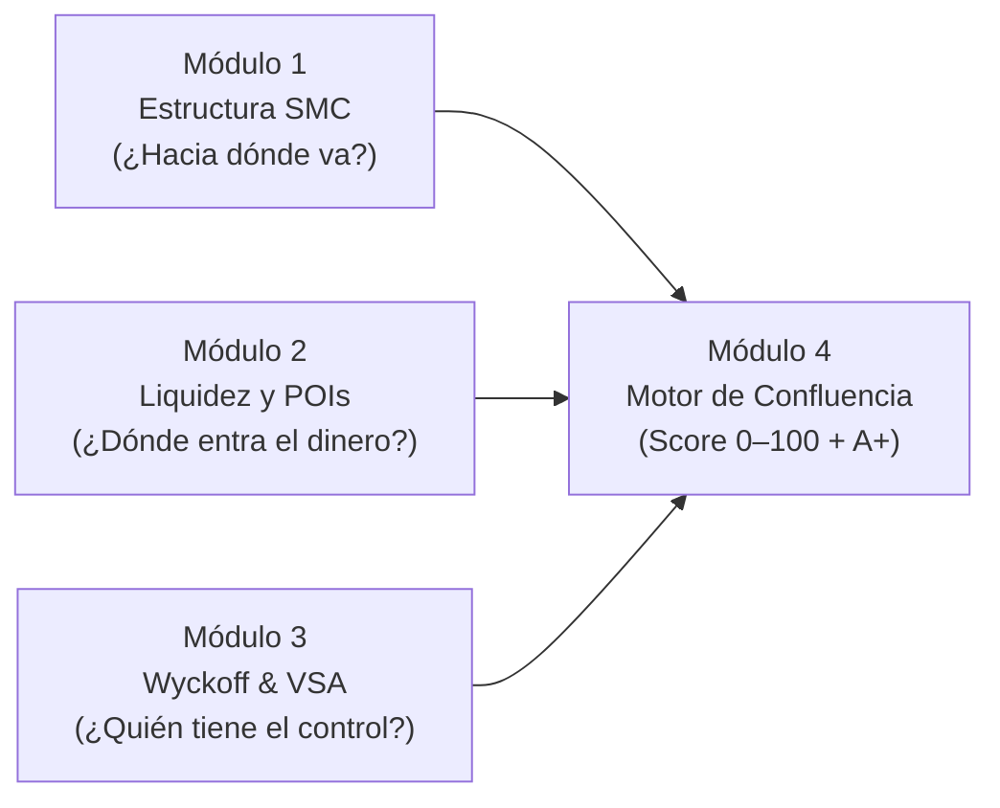

# Guía Educativa Completa — SMC + Wyckoff Institutional Engine

Bienvenido a la documentación educativa del indicador **SMC + Wyckoff Institutional Engine**. Esta biblioteca fue diseñada para que **cualquier persona** —desde quien recién empieza a leer gráficos hasta traders con experiencia— comprenda **en profundidad** cada concepto teórico que da vida al motor, por qué funciona desde la microestructura del mercado y cómo se combinan todas las piezas en tiempo real.

---

## Ruta de Aprendizaje Recomendada

Leé los módulos en este orden para construir el conocimiento de forma progresiva:

| # | Módulo | Qué vas a aprender | Archivo |
|---|---|---|---|
| **1** | **Estructura de Mercado (SMC Core)** | Pivotes, fractalidad (Swing vs. Interna), `BOS`, `CHoCH`, `MSS`, Desplazamiento (`ATR` + Volumen) y zonas `Premium / Discount / Equilibrium`. | [01-estructura-de-mercado-smc.md](./01-estructura-de-mercado-smc.md) |
| **2** | **Liquidez y Puntos de Interés (POIs)** | Cómo opera la liquidez institucional (`BSL`/`SSL`), `EQH`/`EQL` (`$$$`), `Liquidity Sweeps`, `Order Blocks`, `Breaker Blocks` y `Fair Value Gaps` (imbalances). | [02-liquidez-y-pois.md](./02-liquidez-y-pois.md) |
| **3** | **Motor Wyckoff y VSA** | Las 3 leyes de Wyckoff, Volume Spread Analysis (`RVOL`, `Spread`, Absorción), ciclos de Acumulación/Distribución y eventos `SC`/`BC`, `AR`, `ST`, `Spring`/`UTAD`, `SOS`/`SOW`, `LPS`/`LPSY`. | [03-wyckoff-y-vsa.md](./03-wyckoff-y-vsa.md) |
| **4** | **Recap: Cómo lo usa nuestro Indicador** | Integración paso a paso de SMC + VSA + Wyckoff, sistema de puntuación `0–100`, cómo leer una señal `A+`, interpretación del Dashboard, flujo de alertas y errores comunes. | [04-confluencia-y-motor-aplicado.md](./04-confluencia-y-motor-aplicado.md) |
| **+** | **Glosario A–Z** | Referencia rápida de todas las siglas, fórmulas y conceptos del indicador. | [glosario.md](./glosario.md) |
| **⚙** | **Especificación Técnica** | Documento técnico original de arquitectura y reglas algorítmicas en Pine Script v6. | [SPEC.md](./SPEC.md) |

---

## Mapa Conceptual del Sistema

Cada metodología responde una pregunta distinta del mercado:
- **SMC (Estructura)** responde: **¿Cuál es la dirección dominante y si el precio está caro o barato?**
- **Liquidez y POIs** responde: **¿Dónde están las órdenes atrapadas y en qué zonas exactas suele reaccionar el precio?**
- **Wyckoff & VSA** responde: **¿El volumen respalda el movimiento o las instituciones están absorbiendo para girar el mercado?**

Cuando las tres respuestas apuntan en la misma dirección, aparece una oportunidad institucional de alta probabilidad (**Setup `A+`**).
